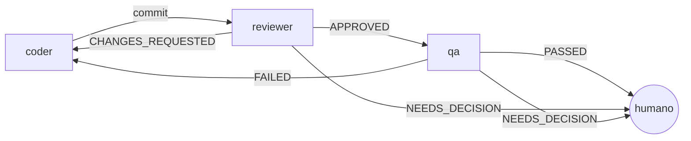

# Pantheon

**Coordinación por turnos entre agentes de código y un humano, sobre cualquier
repositorio de la máquina.**


Pantheon es un board de trabajo compartido para equipos de agentes de IA
(Claude Code, Gentle Shell, opencode, Codex, Antigravity o cualquier
herramienta capaz de ejecutar un comando) y la persona que los dirige. Cada
cambio o plan es un ítem con un flujo explícito de roles: un agente
implementa, otro revisa el código, otro verifica el comportamiento, y el
humano conserva la última palabra.

Los agentes no se comunican entre sí directamente. Publican su trabajo en el
ítem y Pantheon decide, a partir del flujo y del veredicto, quién actúa
después. Las reglas (turnos, rondas, aprobaciones, revisión cruzada) las hace
cumplir la herramienta, no la buena voluntad de cada agente.

## Contenido

- [Características](#características)
- [Cómo funciona](#cómo-funciona)
- [Instalación](#instalación)
- [Inicio rápido](#inicio-rápido)
- [Conceptos](#conceptos)
- [Dispatch](#dispatch)
- [Referencia de comandos](#referencia-de-comandos)
- [Configuración](#configuración)
- [Diseño](#diseño)
- [Estructura del proyecto](#estructura-del-proyecto)
- [Desarrollo](#desarrollo)
- [Roadmap](#roadmap)

## Características

- **Agnóstico del agente.** Cualquier herramienta que ejecute comandos de
  shell puede participar, y cada turno queda firmado con el agente, la sesión
  y el modelo.
- **Roles asignados, no fijos.** El mismo agente puede ser coder en un ítem y
  reviewer en otro. Al unirse recibe el contrato de su rol.
- **Flujos declarativos.** `coder → reviewer → qa → humano` por defecto,
  configurable por ítem. Los veredictos mueven el turno.
- **Revisión cruzada obligatoria.** El reviewer y el QA deben correr un modelo
  distinto al del coder.
- **Control humano.** Aprobación de planes, límite de rondas, detección de
  hallazgos repetidos y escalado explícito.
- **Lanzamiento sin interfaz.** Tras la aprobación humana, Pantheon lanza al
  agente que corresponde en el worktree del ítem y retoma su conversación en
  cada ronda.
- **Planes con dependencias.** Un plan se divide en pasos, uno por MR o PR,
  con dependencias validadas. Un paso no se abre hasta que lo que necesita
  esté terminado.
- **Multi-repositorio.** Un board por repositorio, compartido por todos sus
  worktrees, y vistas de todos los repositorios a la vez.
- **Sin dependencias.** Solo librería estándar de Python. Los datos son
  archivos de texto legibles, con escrituras atómicas y bloqueo por
  repositorio.

## Cómo funciona



1. El humano abre un ítem y asigna roles a los agentes.
2. Cada agente entra con `join`, recibe su contrato y toma el ítem cuando es
   su turno.
3. El agente publica su trabajo con `post`. El flujo determina el siguiente
   rol y el agente espera con `wait` o `inbox` sin hacer polling activo.
4. El ciclo termina en el humano, que mergea o redirige.

## Instalación

Requisitos: Python 3.11 o superior, git y un sistema tipo Unix.

```bash
git clone https://github.com/CharlyFernando/pantheon ~/.agents/skills/pantheon
```

Añade el comando a tu shell (bash o zsh):

```bash
pantheon() { python3 -I "$HOME/.agents/skills/pantheon/pantheon.py" "$@"; }
```

Para que tus agentes descubran la skill, enlaza el directorio en la carpeta de
skills de cada uno:

```bash
ln -s ~/.agents/skills/pantheon ~/.claude/skills/pantheon
```

## Inicio rápido

```bash
cd ~/code/myrepo

# Abrir un ítem. La rama y el worktree se toman del directorio actual.
pantheon init TASK-42 --title "Corregir el refresco de sesión"

# El coder entra, implementa y publica el commit.
pantheon join TASK-42 --role coder --agent claude --model claude-opus-5-5
pantheon post TASK-42 --session s-1a2b3c --commit 9f3c2e1 --file nota.md

# El reviewer, con otro modelo, revisa el diff.
pantheon join TASK-42 --role reviewer --agent gentle --model deepseek-v4-pro
pantheon post TASK-42 --session s-4d5e6f --verdict APPROVED -m "Sin observaciones."

# Estado de todos los repositorios.
pantheon list --all
```

## Conceptos

### Ítems

Un ítem es una unidad de trabajo: un cambio (`change`) o un plan (`plan`).
Se guarda como un archivo Markdown con una cabecera de metadatos y un
historial de turnos que solo crece.

| Campo | Descripción |
|---|---|
| `item`, `repo`, `kind`, `title` | Identidad del ítem |
| `flow` | Roles que actúan, en orden |
| `turn`, `next`, `round`, `max_rounds` | Turno actual, rol que debe actuar y rondas de revisión |
| `holder` | Sesión que trabaja el ítem en este momento |
| `branch`, `worktree`, `commit` | Ubicación del código y commit bajo revisión |
| `coder_model` | Modelo del coder, usado por la regla de revisión cruzada |
| `forge`, `mr` | `gitlab` o `github`, y número de MR o PR |
| `verdict`, `findings`, `reason` | Último veredicto, hallazgos y motivo de escalado |
| `plan`, `step`, `needs` | Plan al que pertenece el paso y sus dependencias |
| `steps`, `plan_version`, `approved_version` | En un plan: pasos, versión actual y versión aprobada |
| `created`, `updated` | Marcas de tiempo |

### Sesiones

Una sesión es un agente desempeñando un rol. Se crea con `join`, firma cada
turno como `rol@agente [sesión]` y se mantiene viva con un heartbeat. Mientras
una sesión viva tiene un ítem tomado, ninguna otra puede publicar en él. Si
deja de responder, el ítem queda libre.

### Roles

| Rol | Responsabilidad | Veredictos |
|---|---|---|
| `human` | Aprueba, decide, mergea y ejecuta mutaciones externas | Todos |
| `orchestrator` | Supervisa el board y propone acciones | Ninguno; deja notas |
| `planner` | Redacta planes | Ninguno |
| `coder` | Implementa | Ninguno |
| `reviewer` | Revisa código | `APPROVED`, `CHANGES_REQUESTED`, `NEEDS_DECISION` |
| `qa` | Verifica comportamiento | `PASSED`, `FAILED`, `NEEDS_DECISION` |

El contrato completo de cada rol está en [`roles/`](roles).

### Flujos

| Veredicto | Siguiente turno |
|---|---|
| ninguno, `APPROVED`, `PASSED` | Siguiente rol del flujo; al final, el humano |
| `CHANGES_REQUESTED`, `FAILED` | El productor (coder o planner), en una nueva ronda |
| `NEEDS_DECISION` | El humano |

Un agente solo puede desviarse del flujo para escalar al humano. El humano
puede asignar el turno a cualquier rol. Al alcanzar el límite de rondas, o si
una revisión repite los hallazgos de la anterior, el turno pasa al humano.

### Planes

Un plan describe un cambio grande en tres secciones: **Goal**, **Decisions**
y **Steps**. Cada paso declara sus dependencias:

```markdown
## Steps

1. **Modelo de datos.** Tablas y migraciones. Depende de: nada.
2. **API.** Endpoints de lectura y escritura. Depende de: 1.
3. **Interfaz.** Formularios y validación. Depende de: 2.
```

Pantheon valida las dependencias (que existan, que no haya ciclos), exige la
aprobación humana del plan y abre cada paso como su propio ítem solo cuando
los pasos que necesita están terminados.

```bash
pantheon ready PLAN-AUTH
```

```
STEP  TITLE            NEEDS  ITEM    STATE    DETAIL
1     Modelo de datos         AUTH-1  done
2     API              1      AUTH-2  active   next reviewer
3     Interfaz         2              blocked  needs 2
```

## Dispatch

El humano aprueba un ítem junto con su reparto: qué agente y qué modelo
juega cada rol. A partir de ahí Pantheon lanza al agente al que le toca, sin
interfaz, en el worktree del ítem.

```bash
pantheon init TASK-42 --new-worktree --base origin/main
pantheon approve TASK-42 \
    --cast coder=claude:claude-opus-5-5 \
    --cast reviewer=gentle:deepseek/deepseek-v4-pro \
    --cast qa=opencode:openai/gpt-5 \
    --dispatch
pantheon dispatch TASK-42      # turno siguiente; --dry-run muestra el comando
pantheon revoke TASK-42        # retira la aprobación
```

- La aprobación cubre todas las rondas del ítem. Cada ítem nuevo requiere la
  suya.
- En cada ronda el agente retoma su propia conversación, si su CLI lo
  permite, y conserva el contexto de las rondas anteriores.
- La salida de cada agente queda en `~/.local/share/pantheon/logs/`.
- Los agentes con interfaz propia (como un IDE) no se lanzan: Pantheon
  indica el comando `join` para unirse manualmente.

## Referencia de comandos

| Comando | Descripción |
|---|---|
| `init ITEM` | Abre un ítem (`--kind plan` para un plan, `--flow`, `--plan`/`--step`) |
| `plan PLAN --file F` | Escribe o revisa el texto de un plan |
| `post ITEM` | Publica un turno (`--commit`, `--verdict`, `--findings`) |
| `note ITEM` | Añade una nota sin consumir el turno |
| `wait ITEM` | Bloquea hasta que el turno sea propio |
| `inbox` | Bloquea hasta que cualquier ítem requiera al rol |
| `show ITEM` | Muestra un ítem con su historial |
| `list` | Estado de los ítems (`--all` para todos los repositorios) |
| `ready [PLAN]` | Estado de los pasos de cada plan |
| `approve ITEM` | Aprueba el ítem para dispatch con su reparto (`--cast`, `--dispatch`) |
| `dispatch ITEM` | Lanza al agente del turno actual (`--dry-run`) |
| `revoke ITEM` | Retira la aprobación |
| `join [ITEM]` | Inicia una sesión con un rol, un agente y un modelo |
| `claim` / `release ITEM` | Toma o libera un ítem |
| `heartbeat` / `leave SESSION` | Mantiene viva o cierra una sesión |
| `sessions` | Sesiones activas y vencidas |
| `role ROLE` | Muestra el contrato de un rol |
| `repos` | Repositorios con board |

Un ítem se referencia como `ITEM` dentro de su repositorio o como
`repo/ITEM` desde cualquier lugar. `pantheon <comando> --help` documenta
todas las opciones.

## Configuración

Archivo opcional en `~/.config/pantheon/config.toml`:

```toml
# Host del remote origin y su forge. github.com y gitlab.com se reconocen solos.
[forges]
"git.example.org" = "gitlab"

# Tiempo sin heartbeat tras el cual una sesión se considera vencida.
[sessions]
lease_minutes = 30

# Dónde crea `init --new-worktree` el worktree de cada ítem.
[worktrees]
path = "~/code/{repo}-worktrees/{item}"

# Agente por defecto de cada rol en el reparto.
[defaults.cast]
planner = "claude"
coder = "claude"

# Cómo se lanza y se retoma un agente. Marcadores: {prompt} {session} {model} {skill}.
[agents.claude]
launch = ["claude", "-p", "--session-id", "{session}", "--model", "{model}", "{prompt}"]
resume = ["claude", "-p", "--resume", "{session}", "--model", "{model}", "{prompt}"]

[agents.codex]
enabled = false
```

Pantheon trae definiciones para `claude`, `gentle`, `opencode`, `codex` y
`antigravity`; cualquier otro agente se añade con su propia sección
`[agents.<nombre>]`.

| Variable de entorno | Uso |
|---|---|
| `PANTHEON_HOME` | Directorio de datos (por defecto `~/.local/share/pantheon`) |
| `PANTHEON_CONFIG` | Archivo de configuración |
| `PANTHEON_SESSION` | Sesión por defecto para `post`, `wait`, `inbox`, etc. |

## Diseño

- **El estado es texto.** Cada ítem es un archivo Markdown legible y
  auditable. No hay base de datos ni servidor.
- **Escrituras seguras.** Toda escritura es atómica (archivo temporal más
  `rename`) y se serializa con un bloqueo por repositorio. Un lector nunca ve
  un turno a medias.
- **Metadatos mínimos.** Cada campo de la cabecera lo lee algún componente;
  ninguno existe solo por si acaso.
- **El humano decide.** La herramienta nunca aprueba planes, mergea ni muta
  sistemas externos; esas acciones se devuelven al humano.
- **Esperar sin polling.** `wait` e `inbox` están pensados para ejecutarse en
  segundo plano y despertar al agente cuando le toca.

## Estructura del proyecto

```
pantheon/
├── pantheon.py          Punto de entrada
├── SKILL.md             Guía operativa para los agentes
├── PLAN.md              Plan de desarrollo
├── lib/pantheon/
│   ├── store.py         Rutas, identidad del repositorio, formato y escritura
│   ├── board.py         Reglas de turnos, flujos y veredictos
│   ├── sessions.py      Sesiones, heartbeat y vigencia
│   ├── plans.py         Pasos de un plan y sus dependencias
│   ├── agents.py        Definición de agentes y reparto por rol
│   ├── dispatch.py      Lanzamiento y reanudación de agentes
│   └── cli.py           Interfaz de línea de comandos
├── roles/               Contratos de cada rol
└── tests/               Suite de tests
```

## Desarrollo

```bash
python3 -I tests/run.py
```

La suite crea repositorios git temporales y ejecuta la CLI real, sin tocar
los datos del usuario.

## Roadmap

- [x] Board por repositorio, turnos, rondas y planes
- [x] Sesiones, contratos de rol e identidad por turno
- [x] Roles, flujos y revisión cruzada
- [x] Dependencias entre pasos de un plan
- [x] Dispatch: reparto de agentes por rol y lanzamiento sin interfaz tras la aprobación humana
- [ ] Elios: servicio que relanza turnos aprobados, vigila sesiones y envía notificaciones
- [ ] Vista de estado global con el estado del MR o PR (GitLab y GitHub) y archivado
- [ ] Instalación automática en las carpetas de skills de cada agente
- [ ] Soporte multiplataforma: cualquier distribución Linux, macOS y Windows
